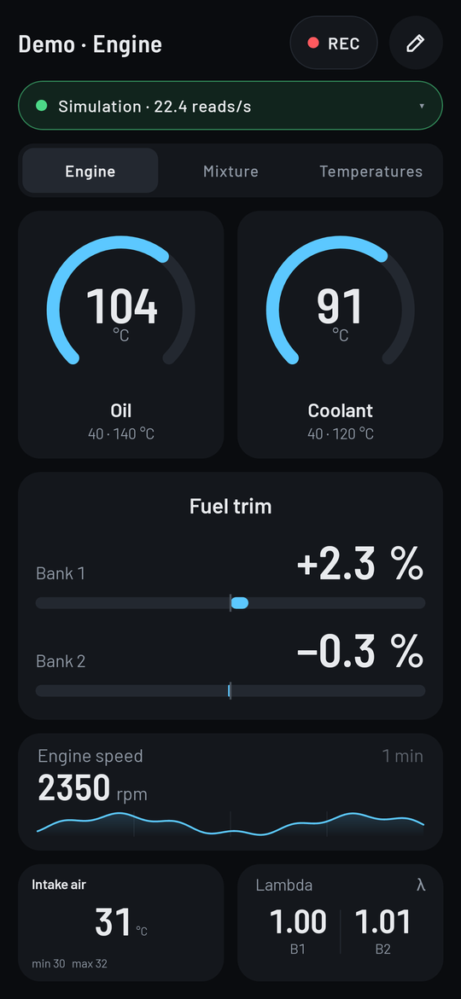
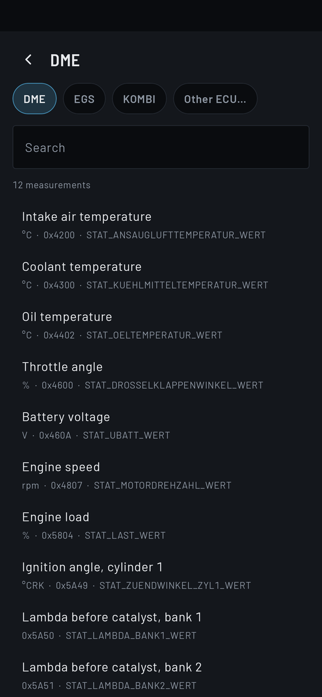
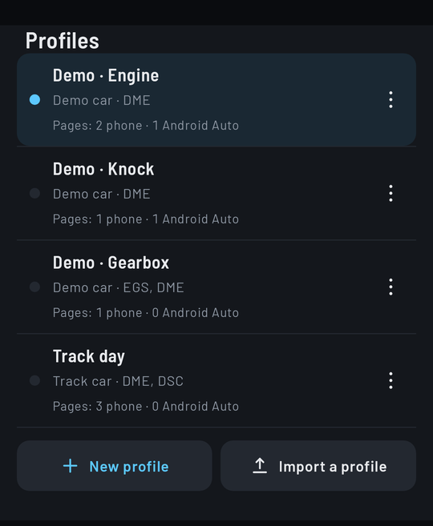
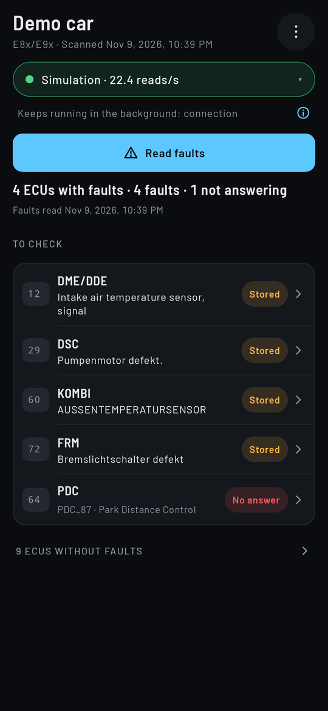
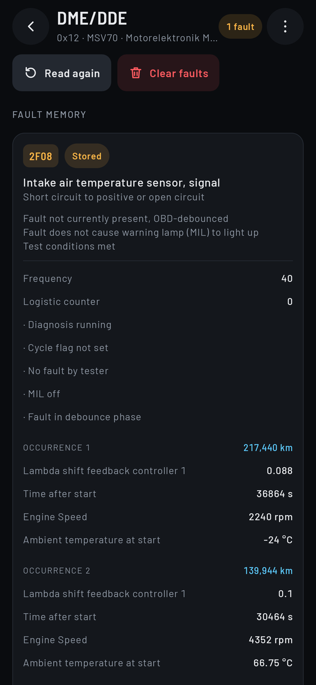
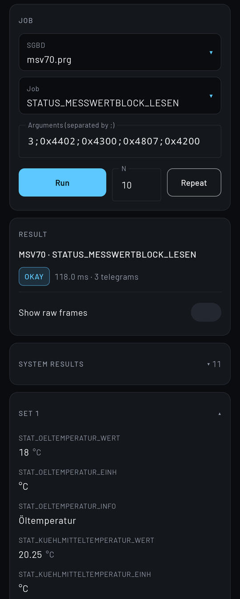
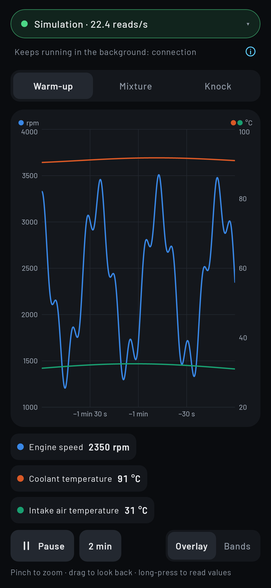
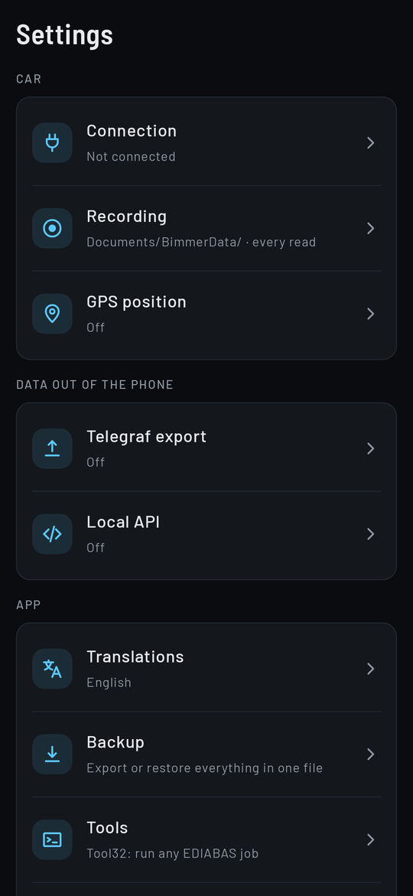
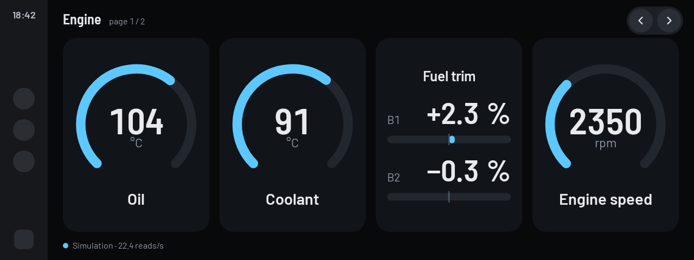

# BimmerData

Open-source Android app for BMW diagnostics and live data: a customizable card dashboard on the
phone and in **Android Auto**, a CSV datalogger, and fault memory read/clear for every ECU.

BimmerData runs the EDIABAS ECU description files (`.PRG` / `.GRP`) itself, like Tool32 or
Deep OBD do, so it works with any car those files describe. **ECU files are not included**:
each user imports their own `EDIABAS\Ecu` folder.

> Status: early development. A "mini Tool32" screen runs any job of any imported SGBD over a
> K+DCAN cable (BMW-FAST on K-line) or against a built-in simulated ECU.

## Screenshots

Rendered from the app with the built-in simulation (demo data, English UI).

<table>
  <tr>
    <td align="center"><br><sub>Card dashboard: dials, bars, trends</sub></td>
    <td align="center"><br><sub>Picking a measurement of the profile's ECUs</sub></td>
    <td align="center"><br><sub>Profiles tab: your cars, the car shown, its profiles</sub></td>
  </tr>
  <tr>
    <td align="center"><br><sub>Fault memory of every ECU of the car</sub></td>
    <td align="center"><br><sub>Fault details, translated ECU texts</sub></td>
    <td align="center"><br><sub>Mini Tool32: any EDIABAS job</sub></td>
  </tr>
  <tr>
    <td align="center"><br><sub>Graph: several values on one time axis</sub></td>
    <td align="center"><br><sub>Settings</sub></td>
    <td></td>
  </tr>
</table>

**Android Auto**



Pictures regenerated with [`tools/readme_screenshots.sh`](tools/readme_screenshots.sh).

## Install

Download `BimmerData-<version>.apk` from the
[GitHub releases](https://github.com/jonathan-gtd/BimmerData/releases) and open it on the phone
(allow installing from your browser or file manager when Android asks). Android 10 or later.
A new release installs over the previous one and keeps your settings, layouts and imported files.

Every release is signed with the same key. You can check an APK before installing it:

```sh
apksigner verify --print-certs BimmerData-<version>.apk
# V2 Signer: certificate SHA-256 digest: f261fe6cc0acba09ffbb5caf9b96f6da947bce7bf5dc8c6568973dd3de8cd12c
```

The SHA-256 of each APK is published next to it in the release.

Then: **Settings › Tools › Tool32 › Import** to import your own `EDIABAS\Ecu` folder (copied from a PC).

## Hardware

- K+DCAN USB cable (FTDI) over USB-C OTG — first target (E-series, K-line, BMW-FAST).
- Bluetooth adapter with the Deep OBD firmware (e.g. an ELM327 with the
  [replacement firmware](https://github.com/uholeschak/ediabaslib/blob/master/docs/Replacement_firmware_for_ELM327.md)),
  Bluetooth classic. See [docs/BLUETOOTH.md](docs/BLUETOOTH.md).

Supported EDIABAS concepts so far: BMW-FAST (0x010F). DS2, KWP2000\* and D-CAN are planned.

## Mini Tool32

1. Copy your `EDIABAS\Ecu` folder to the phone, then **Import Ecu folder** and pick it
   (only `.prg` / `.grp` are copied into app storage; a re-import replaces them).
2. Tap **Connect** and choose the **USB cable** (e.g. a K+DCAN-type FTDI cable via OTG), a
   **Bluetooth adapter** (Deep OBD firmware) or the **Simulation**; ignition on for a real car.
3. Pick an SGBD (the `.prg` of an ECU of your car; for a `.grp` use **Identify variant**), pick a job, enter
   arguments separated by `;` (e.g. `STATUS_MESSWERTBLOCK_LESEN` with `3;0x4402;0x4300`), **Run**.
4. Results show every result set, JOB_STATUS, the job time and the telegram count; **Show raw
   frames** lists the telegrams sent / echoed / received with timestamps; **Repeat** runs the job
   N times and shows average, min and max time.

Safety: the interface refuses flashing, coding writes, security access and the programming
session before anything is sent to the car. Fault memory clear is allowed.

## Cars

The app is organized **car → profiles → pages**. Each car has its own profiles, its ECU list and
its fault reports; one car is shown at a time (the profiles, the Faults tab and the Telegraf
`car` tag follow it).

- **At each connection** the app reads the car's VIN (about a second, read-only): a known car is
  shown with its last used profile (only proposed while a CSV recording runs), an unknown VIN
  adds a new car "Car <VIN>" (rename it). A car added by hand gets its VIN at its first connection.
- **The Profiles tab** (bottom bar) shows your cars at the top (one tap shows another car, **Add**, **Manage** = My cars), then the car shown: its VIN state, series and model, its ECU list and
  last detection, with **Detect** and **ECUs** (pick them by hand) buttons and rename in ⋮; below,
  its profiles (activate, new, import, ⋮ to edit, duplicate, copy, export, delete). With no car yet, the tab says how to get one (connect, or
  **Add a car** by hand).
- **My cars** lists every car (VIN state, series, profiles, ECUs; its ⋮ menu: show, detect, ECUs,
  rename, delete with its profiles after a confirmation). It opens at start when there are several
  cars, from the Profiles tab and from the profile switch (**Change car**).
- **Detect ECUs** (connected, ignition on) finds the car's ECUs and their ECU files and keeps them
  in the car's ECU list; ECUs can also be picked by hand from the imported ECU folder. A profile's
  main ECUs come from its car's list, and the card picker opens on them. When a new detection no
  longer finds an ECU that profiles use, or when you remove one by hand, the app asks before
  removing it from those profiles (with their cards); "Keep" leaves it in the list.
- **Copy to another car** (Profiles tab, profile ⋮) starts another car from a tuned profile. Shared
  profile files carry series and model, never the VIN.

## Faults

The tab reads the fault memory of every ECU of the shown car's list (detected from the Profiles tab; a car
without ECU list gets a one-tap **Detect ECUs** here). The last read stays readable away from the
car and can be shared. The car's ECUs also come first in the card picker and get their
translations downloaded.

- The tab shows the faults first: a summary line, then the ECUs **to check** (with their most
  urgent fault, translated, and a chip **Present** / **Stored** / **Never occurred**) and those
  not answering; the ECUs without faults fold into one line. Share, clear all, the bus view, the
  car choice, rename and forget are in the ⋮ menu.
- An ECU shows its faults (text and symptom; the details on tap) and its **functions**, like a
  workshop tester: **Reads** (states and values, one tap) and **Tests and controls** (actuators,
  self tests), with a field per argument and the help of the ECU file. A test asks for a
  confirmation every time and is refused while the car moves (a fresh DME or GPS speed above
  2 km/h). Coding, programming, writes, adaptations, resets and memory clears are never offered
  there. Tool32, the identification and the export for translation are in the ⋮ menu.

## Graphs

The **Graph** tab draws several values of the active profile's cards (phone and Android Auto
pages) on one time axis, live. Each profile has its own named graphs, kept with the profile
(export / import included).

- **Axes**: values with the same unit share a vertical axis, the first two units get an axis
  each (left and right); **Bands** gives every value its own band and scale on a common time axis.
- **Time**: the window works like the trend cards (5 s to 60 min, double-tap to switch); pinch to
  zoom, drag to look back (this pauses), **Live** to come back. A long press shows the values
  under the finger.
- **Landscape**: the app stays in portrait, except this tab: turn the phone and the graph takes
  the whole screen (legend and controls on the side), with the same pause, zoom and cursor.
- **Colors and legend**: one color per value from a fixed palette (a value keeps its color when
  others are added or removed); tap a legend entry to hide or show its curve.
- **No extra reads**: a graph shows values of the profile, which is read whole (see
  [What is read](#what-is-read)); the curves come from the history of these readings (the last
  hour, while the app runs). Time with no reading shows as a gap in the curve.

## What is read

While connected, the app reads the **whole active profile** (every phone and Android Auto page),
the page shown first: the screens, the graphs, the CSV recording and the Telegraf export have
every value of the profile whatever the page shown, with no hole in the curves.

**Read like TestO and Deep OBD** (nothing to set): every read runs the ECU file's
`STATUS_MESSWERTBLOCK_LESEN` job with `JA` (clear, define and read the dynamic block: 3
telegrams), with at most **16 values per block** and at most **8 reads per second per ECU**
(125 ms start to start). More values on one ECU make several blocks that take turns, so each value
is read less often (17–32 values: about 4 times a second). The app never defines a block once and
then asks for it back to back: done that way with 40 values, an MSV70 engine ECU misfired and the
whole car glitched (every needle to zero, "DSC communication" fault, cruise control off).

If the car stops answering while reading (timeout, transmission error), the app **slows down by
itself**: the interval doubles, up to 1 s; after 3 minutes without incident it is halved again,
never below 125 ms. The read statistics (interval, slow-downs, reads without answer...) go to the
Telegraf export as `ecu = 'bimmerdata'` (see [docs/TELEGRAF.md](docs/TELEGRAF.md)).

A small profile is read more often than a big one: split a big profile into smaller ones (one per
subject: knock, lambda, fuel...) when you need fast curves.
A profile holds at most **42 values** (all its pages together, a value shown twice counts once):
one ECU's dynamic block holds 42 values (its define telegram has a one-byte length, 2 + 6 bytes
per value), and the app refuses a card or a profile file that would make more. A profile made by
an older version with more values is still read, but only its page shown.

## Settings

- **Connection**: auto-connect on the cable, and the **Bluetooth adapter**: pick it among the paired
  devices, connect at app start, read its firmware, voltage and CAN mode (see
  [docs/BLUETOOTH.md](docs/BLUETOOTH.md)).
- **Tools › Tool32**: the mini Tool32 above. It also opens from an ECU's detail (Faults tab,
  **Jobs (Tool32)**) with that ECU's SGBD already selected.
- **Recording**: CSV files go to `Documents/BimmerData/`, or to a folder you choose (Android
  folder picker); row rate (every read cycle, or at most 10/5/2/1 rows per second) and file
  name prefix.
- **Telegraf export**: live values to Telegraf → TimescaleDB → Grafana, live or after the trip
  over home Wi-Fi. See [docs/TELEGRAF.md](docs/TELEGRAF.md) and [deploy/telegraf/](deploy/telegraf/).
- **Backup**: one file with everything to get the app back after a reinstall or on a new phone:
  your cars (with their VIN: keep the file private), their ECU lists, last detection and fault
  read, every profile with its phone and Android Auto pages and graphs, and the settings. Never a
  token or password; the ECU files are imported again. Restore replaces everything, all or nothing.
  Also through the Local API (`GET /api/v1/backup`, `POST /api/v1/backup/restore`).
- **Automatic backup**: Android's own app backup to your Google account keeps cars, profiles,
  graphs, settings and translations, and puts them back by itself when the app is installed
  again from Google Play, Telegraf token/password and Local API token included (the backup
  is end-to-end encrypted with the screen lock). Not in it: the ECU files (import them again).
- **Local API**: REST/JSON API for scripts and AI agents, with Swagger UI built in and optional HTTPS (the phone's own certificate, pinned or trusted once). See
  [docs/API.md](docs/API.md).

## Android Auto

The car pages of the dashboard (edited on the phone: **Edit** › **Android Auto**) are shown in
Android Auto with the same card renderer as the phone, full screen, next to the media card, or as
a small card next to another app (cards then reflow on two columns). Tap the screen to show the
buttons: previous / next page and **Connect** (USB cable, Bluetooth adapter once chosen on the
phone, or Simulation).

BimmerData uses the Car App Library as a *navigation* app, because that is the only category that
lets an app draw its own screen; it never starts route guidance. If a head unit refuses to hand
over the drawing surface, the same cards are shown as a grid template, refreshed every second.

Live data is shared with the phone: what is visible on the car screen and on the phone screen is
read together; a phone in the pocket (screen off) does not slow down the car screen.

Since the APK is not installed from Google Play, Android Auto only lists it with its developer
settings enabled: on the phone, **Settings › Connected devices › Connection preferences › Android
Auto**, tap **Version** ten times, then **⋮ › Developer settings** › tick **Unknown sources**.

## Building

Requirements: JDK 21 and the Android SDK (`ANDROID_HOME` set).

```sh
./gradlew :ediabas:test :app:assembleDebug
```

Tests that need real ECU files read them from `BIMMERDATA_ECU_DIR` (your own `EDIABAS\Ecu`
folder) and are skipped when it is not set.

Release APK (signed when `~/.config/bimmerdata/release.properties` exists, with `storeFile`,
`storePassword`, `keyAlias`, `keyPassword`; or the `BIMMERDATA_KEYSTORE`,
`BIMMERDATA_STORE_PASSWORD`, `BIMMERDATA_KEY_ALIAS`, `BIMMERDATA_KEY_PASSWORD` variables;
otherwise it is built unsigned):

```sh
./gradlew :app:assembleRelease
```

R8 shrinks and optimizes the release build but does not obfuscate it (`app/proguard-rules.pro`).

Inspect an ECU file from the command line:

```sh
./gradlew :ediabas:prgDump --args="/path/to/Ecu/<ECU>.PRG"              # jobs and tables
./gradlew :ediabas:prgDump --args="/path/to/Ecu/<ECU>.PRG MESSWERTETAB" # one table
```

## Credits

The EDIABAS file handling and job interpreter are a Kotlin port of
[EdiabasLib](https://github.com/uholeschak/ediabaslib) by Ulrich Holeschak (GPL-3.0).

The dashboard uses the [Barlow](https://github.com/jpt/barlow) and Barlow Semi Condensed fonts
by Jeremy Tribby (SIL Open Font License 1.1, copied from
[google/fonts](https://github.com/google/fonts); license texts in `app/src/main/assets/licenses/`).

BMW, EDIABAS and related names are trademarks of their respective owners. This project is not
affiliated with or endorsed by BMW.

## License

GPL-3.0-or-later. See [LICENSE](LICENSE).
